# GoPxL 系统集成与通信 (Communicate)

📝 手册更新日志 (Changelog)

| 说明书版本 | 更新日期 | 更新者 | 更新说明 |
| --- | --- | --- | --- |
| **V1.0** | `2026-5-27` | **Ruiyi Chen** | 完成了大部分通讯的说明，剩下待补充 |
| **V0.8** | `2026-04-01` | **Alfred Pu** | 完成纯文字版本，还需要截图 |

在完成扫描成像（Acquire）和工具检测（Inspect）后，最后一步是将测量结果、Pass/Fail 判定或 3D 点云数据发送给外部系统。

在 GoPxL 的 **Communicate (通信)** 页面，您可以配置传感器与 PLC、机器人、剔除机构或定制上位机软件的交互逻辑。

[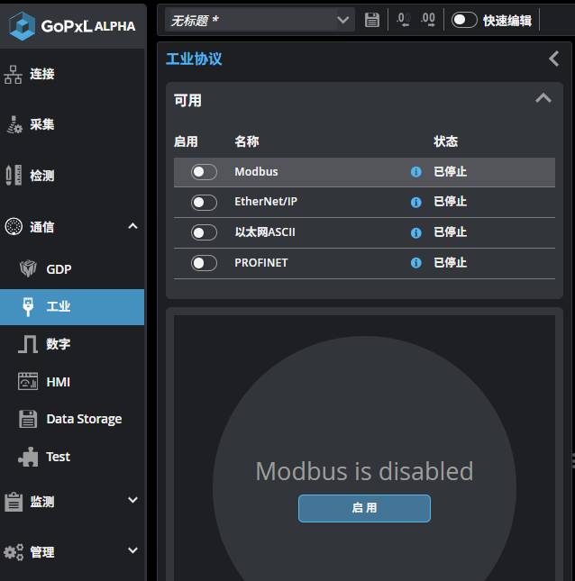](../images/gopxl_integration/b9c0f608-56e3-405f-839a-3bb6ea301a93.png)

*通讯页面*

---

## 1. 硬件输入与输出 (Digital I/O)

通过传感器尾部的 I/O 线缆，GoPxL 可以直接与底层的硬件电气信号进行交互。

### 1.1 硬件输入信号 (Inputs)

- **触发信号 (Trigger)**：接收光电传感器等外部设备的数字输入信号，用于精确控制传感器何时开始扫描。
- **编码器信号 (Encoder)**：接收传送带编码器的 A/B/Z 相位信号，用于在运动过程中按固定物理间距（如每 0.1mm）触发扫描，确保 3D 比例不失真。

### 1.2 硬件输出与追踪 (Digital Output & Tracking)

数字输出通常用于直接控制执行机构（如气缸、报警灯）。
GoPxL 提供了一个非常强大的工业级功能：**输出追踪 (Output Tracking)** 。
在实际生产线上，传感器扫描位置与最终的废品剔除闸门之间通常有一段距离。GoPxL 允许您为数字输出设置“延迟”。由于传送带使用编码器或匀速运行，系统可以对目标进行“追踪标记”，在有缺陷的零件精确移动到剔除机构下方时，才触发数字输出信号 。

[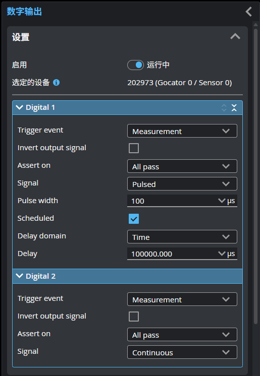](../images/gopxl_integration/数字输出.png)

*数字输出设置*

!!! warning "注意：不再支持模拟量与串口"
与早期的 Gocator 6.x 固件不同，GoPxL 系统\*\*不再支持模拟量 (Analog) 和串行 (Serial) 输出\*\* 。建议全面转向基于以太网的工业协议。

---

## 2. 工业协议通信 (Industrial Protocols)

GoPxL 原生支持主流的以太网工业协议，方便与各家品牌的 PLC（如西门子、三菱、欧姆龙、罗克韦尔）无缝对接。

### 2.1 支持的协议

在 **Communicate > Industrial** 页面，您可以一键开启以下协议：

[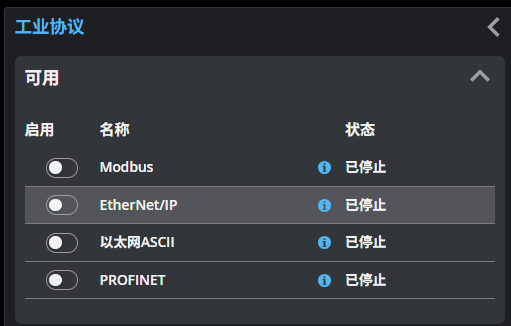](../images/gopxl_integration/工业协议.png)

*工业协议种类*

- **EtherNet/IP**：常用于 Allen-Bradley / Rockwell PLC，支持隐式 (Implicit) 和显式 (Explicit) 消息传递，系统内置 EDS 文件供下载。
- **PROFINET**：常用于 Siemens (西门子) PLC。
- **Modbus TCP**：通用的工业标准协议，GoPxL 作为 Modbus Server（从站）运行。
- **Ethernet ASCII**：基于字符串的轻量级以太网协议，适合通过简单的文本命令（如机械臂上位机）控制传感器。

### 2.2 配置输出映射 (Connections Map)

无论您选择哪种工业协议，将检测数据发送给 PLC 的配置逻辑是高度一致的：

1. **开启协议**：在 Available protocols 列表中打开对应协议的开关（如 EtherNet/IP）。
2. **添加连接 (Add Connections)**：在下拉菜单中选择您要输出的数据源（Source）。
   - 可以是 **Measurements (测量值)**（如工具测量出的长、宽、高）。
   - 可以是 **System State (系统状态)** 或 **Stamps (时间戳/帧号)** 。
3. **管理地址 (Reindex)**：添加后，数据会出现在底部的 Connections 列表中。系统会自动为它们分配寄存器地址。您可以通过拖拽改变顺序，或点击 **Reindex...** 重新整理内存地址排布，确保与 PLC 端的接收区一一对应 。

### **🎯 Modbus TCP通讯**

开启modbus 配置输出项 读取输出数据

- **开启modbus协议**：工业协议->启用modbus->状态显示运行中。

[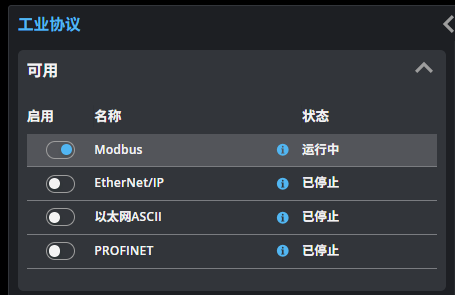](../images/gopxl_integration/modbus/ScreenShot_2026-05-09_174653_581.png)

*开启modbus*

- **配置工具(非必需)**：检测->拖取需要工具->勾选需要的输出。
- **配置输出**：modbus页面->添加输出。输出包含有传感器信息和测量结果，按需要选择

[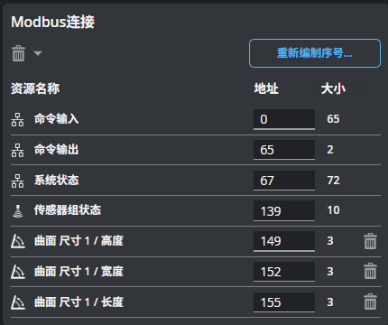](../images/gopxl_integration/modbus/ScreenShot_2026-05-09_174703_248.png)

*配置输出项*

- **读取**：在传感器modbus页面能看到每个测量值的地址和长度，在配置好IP、端口号、地址、长度等即可读取到short类型的数组,每3个寄存器一组存储一个数据。
- **数据解析**：第一个为测量结果的正负号；第二个为决策值；第三个为测量值。接收到的数据除以1000即为mm单位的值，其中无效值为-32768。

[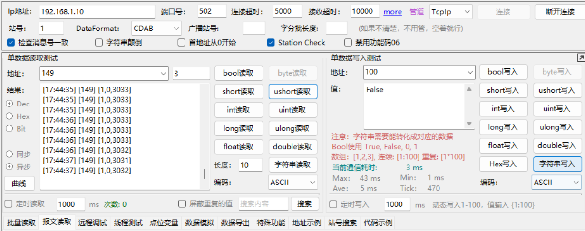](../images/gopxl_integration/modbus/ScreenShot_2026-05-09_174543_517.png)

*读取输出数据*

### **🎯 EtherNet/IP通讯**

开启并配置输出项 数据输出与解析

- **开启与配置**：同样地设置好输出后启动传感器。注意，该通讯底层经过了CIP封装，并非简单的TCP/IP。

[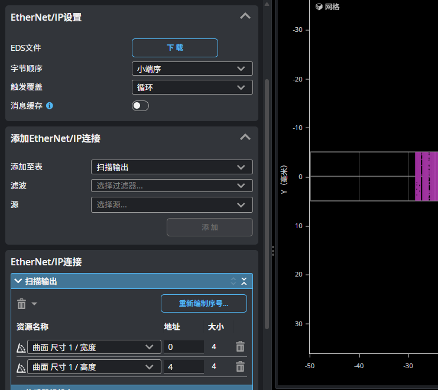](../images/gopxl_integration/EIP/ScreenShot_2026-05-11_173256_068.png)

*开启并配置输出项*

- **读取**：启用EIP模拟器连接传感器接收数据，采用小端序接收（低位字节在前）。
- **数据解析**：每个测量值是4个字节，通过组合成16进制后转化为10进制。此时单位是μm，除以1000即为mm单位。无效值为0、0、0、128。
- **解析示例**：如下图 251 62 0 0 转化过程：  
  字节 0 (251) = 0xFB  
  字节 1 (62) = 0x3E  
  字节 2 (0) = 0x00  
  字节 3 (0) = 0x00  
  组合成十六进制数为：0x00003EFB，转换为十进制为 16123，除以1000即为 16.123 mm。

[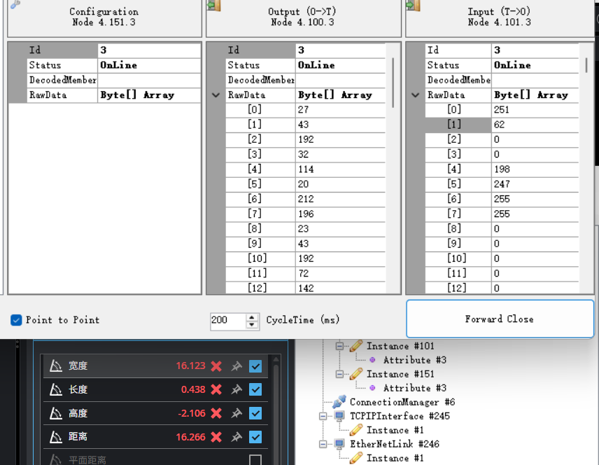](../images/gopxl_integration/EIP/e993dc09-3f00-43a8-8b1d-28f9540c2f68.png)

*接收数据*

### **🎯 以太网ASCII通讯**

开启并配置输出项 读取输出数据

- **开启与配置**：设置好输出后启动传感器。选择“启用异步”，异步格式模式选择“标准”，并设置好IP和端口（默认8190）。
- **自定义格式**：接收的数据格式可以直接在传感器端进行自定义配置。

[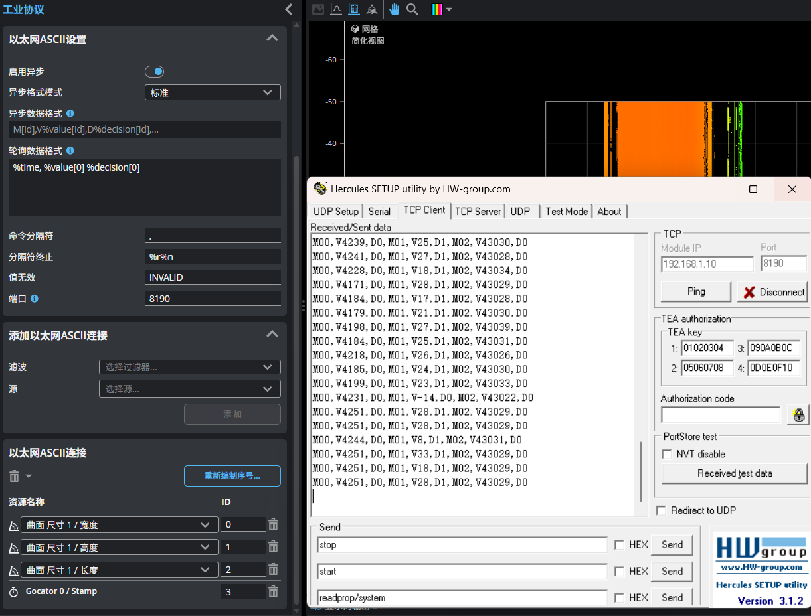](../images/gopxl_integration/ASCII/ScreenShot_2026-05-12_104350_538.png)

*开启并配置输出项*

- **读取**：连接成功后即可实时接收数据。
- **数据解析**：接收到的数据单位同样为μm，遇到无效值时会直接显示为 INVALID。

[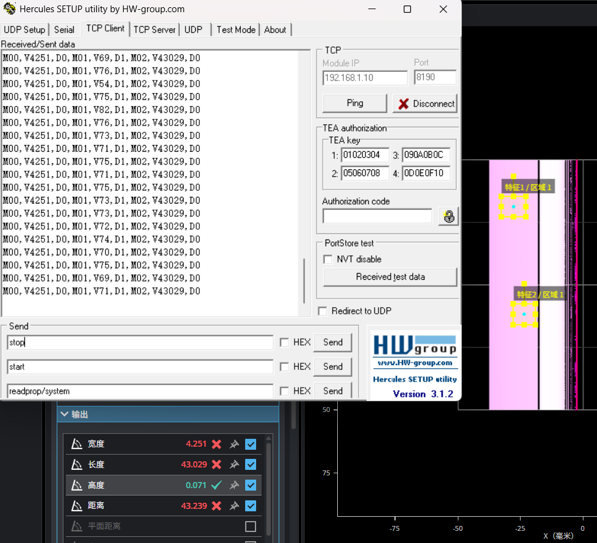](../images/gopxl_integration/ASCII/ScreenShot_2026-05-12_103243_526.png)

*接收数据*

---

## 3. 双向交互：接收 PLC 的输入数据

除了输出，GoPxL 也可以接收来自 PLC 的数据并参与到工具链的计算中。

### 3.1 接收 PLC 动作指令 (Control Input)

通过协议的 `Control Input` 寄存器块，PLC 可以发送命令给传感器，例如：  
\*\* 开始/停止传感器扫描 。   
\*\* 动态切换 Job (任务) 文件，以适应不同产品的换型 。   
\*\* 触发系统标定 (Alignment) 。

这里演示通过以太网ASCII控制传感器开关、切换Job等，更多功能详见[用户手册](https://ap.lmi3d.com/manuals/gocator/gocator-6.5/G2/Default.htm#Tools_Drivers/Integrations.htm?TocPath=Integrations%257C_____0)。

通过以太网ASCII控制传感器

### 3.2 用户数据输入工具 (User Data Input Tool)

如果您需要将 PLC 中的业务数据（例如：当前产品的批次号、条码字符串，或动态的公差阈值）传入 GoPxL，可以使用 **User Data Input** 工具 。
该工具会监听 EtherNet/IP 或 SDK 传来的自定义数据流，并将其转化为工具输出，供后续的检测工具（如条件逻辑）或数据导出服务（如命名导出的图像文件）使用 。

---

## 4. GoPxL 数据协议与 SDK (GDP & API)

对于不使用 PLC，而是由工控机（PC）使用 C/C++、C# 或 Python 开发定制上位机软件的场景，系统提供了 **GoPxL 数据协议 (GDP)**。

### **GDP协议通讯**

- **开启 GDP**：在 Communicate > GDP 页面配置，可选择输出最原始的 3D 轮廓、表面点云，以及所有的测量结果。
  **GoPxL SDK 与 REST API**：GDP 协议配合官方免费提供的 GoPxL SDK 使用，客户端程序可以接收高速、大吞吐量的 3D 数据帧，同时也可以读取/写入系统配置。下面以 C# SDK 为例描述大致流程：

开启GDP 配置SDK工程 运行SDK与读取数据

- **启用协议**：在通讯列表中打开 GDP 数据协议，并在“Add Connections”处添加需要输出的信息。如果要获取工具输出，则需要提前配置好相关工具。

[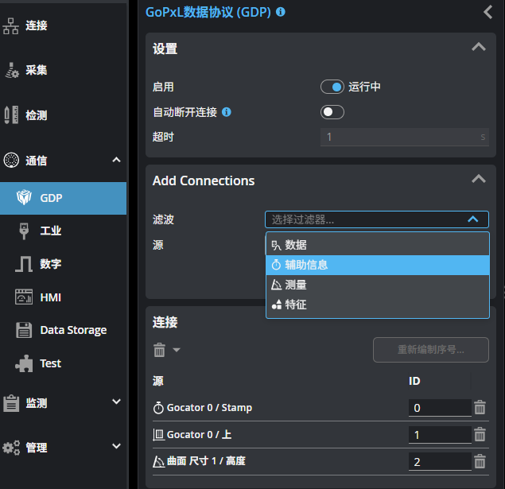](../images/gopxl_integration/GDP/3.png)

*开启GDP*

- **初始化工程**：打开 C# SDK 工程，初始化整个解决方案，在“sample”里面选择需要的功能并将其设置成启动项。

点击展开/折叠 GoPxLSdkNet SDK C# 接口库列表

- **GoPxLSdkNet** SDK的C#接口库，不可运行。
- **AlignSensorNet** 传感器校准。
- **BackupRestoreNet** 传感器文件备份与恢复。
- **ConfigureSensorNet** 更改传感器配置。
- **ConfigureToolNet** 传感器添加工具，更改工具配置，并启用测量数据输出。
- **DiscoverNet** 在网络上发现传感器和GoPxL实例。
- **MultilayerOutputsNet** 光谱共焦传感器单层和多层点云输出。
- **MultiSensorLayoutNet** 多传感器连接与布局设置，包括多层数据输出。
- **ReceiveAsyncNet** 通过异步方式接收传感器的数据。
- **ReceivelmageNet** 2D相机的图像输出。
- **ReceiveMeasurementNet** 传感器内置工具的测量值输出。
- **ReceiveMetricsNet** 传感器指标值输出。
- **ReceiveProfileNet** 传感器轮廓数据输出。
- **ReceiveSurfaceNet** 传感器点云数据输出。
- **ReplayDataNet** 传感器数据记录设置、文件的保存与载入(.gprec)。
- **SaveJobNet** 传感器作业文件获取、设置、保存与加载。
[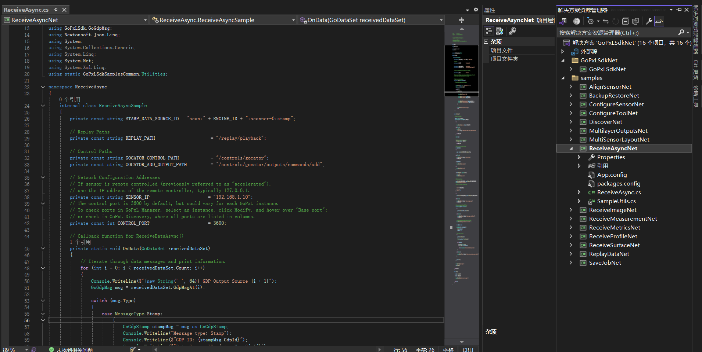](../images/gopxl_integration/GDP/2.png)

*设置工程环境*

- **运行与读取**：设置好 IP 地址与 GDP 的端口后，运行所需要的工程文件，在 CMD 命令行中即可实时看到传感器返回的信息。

[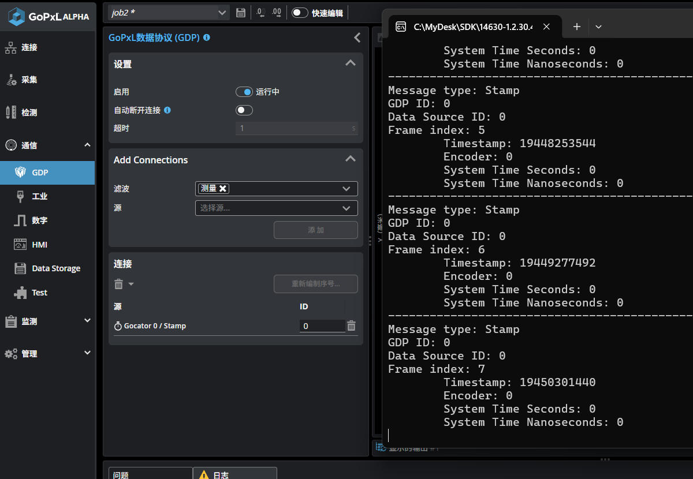](../images/gopxl_integration/GDP/1.png)

*读取输出数据*

!!! warning "注意事项"
\* \*\*GDP设置\*\*：示例代码会包含一些GDP开启、添加输出等设置，如果您已经手动设置好，可能需要注释相关代码，以免报错。
\* \*\*同步/异步\*\*：实际的应用过程中大多数是使用异步接收数据，如果实在需要同步接收，则需要自行管理好时序、处理时间等问题，以免发生线程、内存冲突等问题。在SDK示例代码中测量值、轮廓、点云等数据输出都是同步的方式，需要异步接收则需要同时参考“ReceiveAsyncNet”这个工程。

---

## 5. 数据存储与自定义界面 (HMI)

- **数据导出 (Data Storage)**：在 Communicate 页面中，您可以配置将扫描的原始数据或测量结果直接保存到远端的 **FTP 服务器**，或者（在 PC/GoMax 环境下）保存到本地文件夹，用于后续的追溯或 AI 模型训练 。

  - **FTP与SFTP核心差异对比表**：

  | 特性 | FTP (File Transfer Protocol) | SFTP (SSH File Transfer Protocol) |
  | --- | --- | --- |
  | **全称** | 文件传输协议 | SSH 文件传输协议 |
  | **底层协议** | TCP | SSH (Secure Shell) |
  | **安全性** | 明文传输（账号、密码和数据均不加密） | 加密传输（所有数据、密码均高强度加密） |
  | **连接端口** | 使用多个端口（默认命令端口 **21**，数据端口随机） | 仅使用一个端口（默认 **22**） |
  | **防火墙友好度** | 差（动态端口经常被防火墙拦截） | 好（只需开放一个端口即可） |
  | **传输速度** | 理论上稍快（因为没有加密解密的开销） | 稍慢（CPU需要时间进行加密解密） |
  | **认证方式** | 仅支持用户名和密码 | 支持用户名/密码，以及更安全的 **SSH 密钥对** |
- **FTP/SFTP配置与通讯**：这里用的是本地的FTP/SFTP模拟服务器，实际的应用场景多为工厂的云端服务器、MES系统等，如果是保存在本地电脑建议使用GDP的方式，会有更多的信息和功能。

FTP设置

- **GoHMI 界面**：GoPxL 内置了 GoHMI Designer。它允许您无需编写任何前端代码，即可拖拽生成一个基于网页的、供现场操作员使用的自定义监控大屏（支持 PC、触摸屏或移动设备）。
