# Gocator (GoPxL) 快速使用指南

📝 手册更新日志 (Changelog)

| 说明书版本 | 更新日期 | 更新者 | 更新说明 |

| **V1.0** | `2026-04-13` | **RuiYi Chen** | 细化了操作步骤和指示说明，增加了插图 |

| **V0.9** | `2026-04-09` | **Alfred Pu** | 丰富开箱连线、网络启动与快速出图指南，补充图文结构 |

| **V0.8** | `2026-04-01` | **Alfred Pu** | 完成纯文字版本，还需要截图 |

欢迎使用 GoPxL！本指南涵盖了从硬件开箱、连线配置到最终输出数据的核心步骤，帮助您快速上手 Gocator 传感器。

---

## 1. 开箱与硬件概览 (Unboxing & Hardware)

拿到 Gocator 传感器后，请先熟悉设备外观及主要接口：

- **光学窗口**：包含顶部的 CAMERA（激光接收窗口）和前侧的 LASER EMITTER（激光发射窗口）。
- **指示灯状态面板**：包含 POWER（电源指示灯）、RANGE（范围指示灯）、LASER（激光指示灯）以及网口状态灯，用于快速确认设备运行状态。
- **尾部接口**：
  - **I/O CONNECTOR (I/O连接端子)**：用于连接编码器输入、外部触发输入以及数字/模拟/序列输出。
  - **POWER & LAN CONNECTOR (电源及网口连接端子)**：用于连接电源（24V/48V）、以太网通信以及激光安全互锁。

[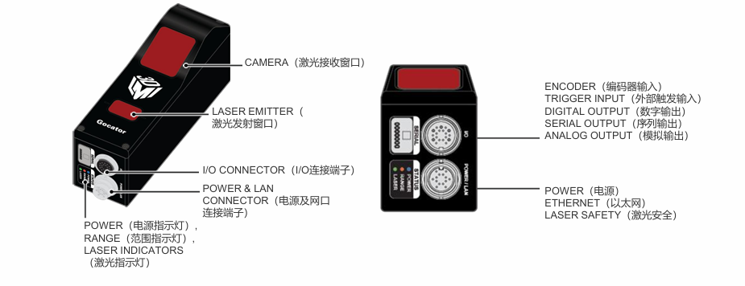](../images/gopxl_quickstart/硬件介绍.png)

*硬件示意图*

---

## 2. 硬件连线与上电 (Wiring)

Gocator 提供了两种主要线缆，请根据线缆颜色和用途进行正确连接：

[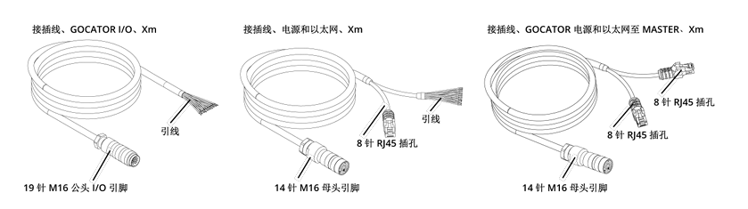](../images/gopxl_quickstart/接插线.png)

*接插线*

### 2.1 主线缆连接 (Power & Ethernet)

- **识别线缆**：此线缆通常为**黑色**，一端为传感器连接头，另一端分叉。
- **连接电源**：将裸线端接入 24V 或 48V 直流电源。**请严格注意正负极**。
- **接地线 (PE线)**：线缆中包含一根金属编织的接地线（PE线），**务必将其与大地或机柜地牢固连接**，以抵抗工业现场干扰并确保安全。
- **以太网连接**：将 RJ45 水晶头端接入工控机（PC）的网口或千兆交换机。

单传感器连接 多传感器连接

[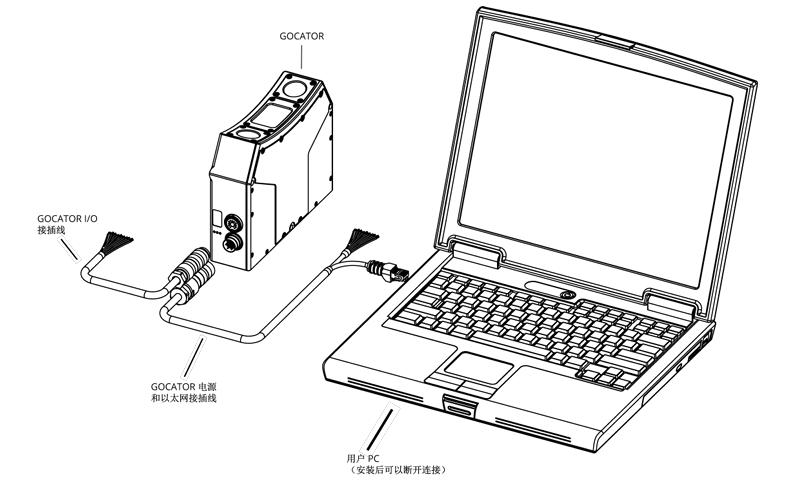](../images/gopxl_quickstart/单传感器.png)

*单传感器连接示意图*

需要增加master和交换机，同时线缆更换成双网口线。

[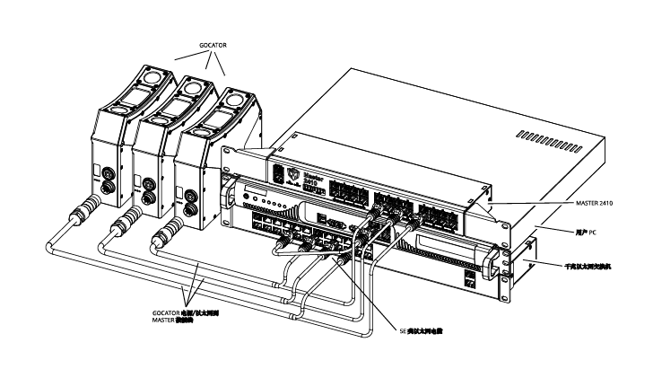](../images/gopxl_quickstart/多传感器.png)

*多传感器连接示意图*

### 2.2 I/O 线缆连接（可选）

- **识别线缆**：I/O 线缆通常为**灰色** 。
- **连接触发/编码器**：用于连接外部接触发端（I/O Open Wire），例如高/低电平触发信号（3.3V-24V）或 5V 差分编码器信号 。

!!! warning "接线注意事项"
\* \*\*扭矩限制\*\*：连接传感器端子时请用手拧紧，扭矩\*\*不要超过 2 Nm\*\*。
\* \*\*线缆换向\*\*：如空间紧凑使用弯头线缆，该接头支持每 90 度换一次方向，方便走线 。

端口介绍 PE线连接图 IO线连接图

[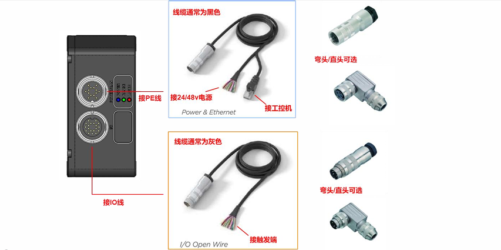](../images/gopxl_quickstart/端子头.png)

*端口介绍*

[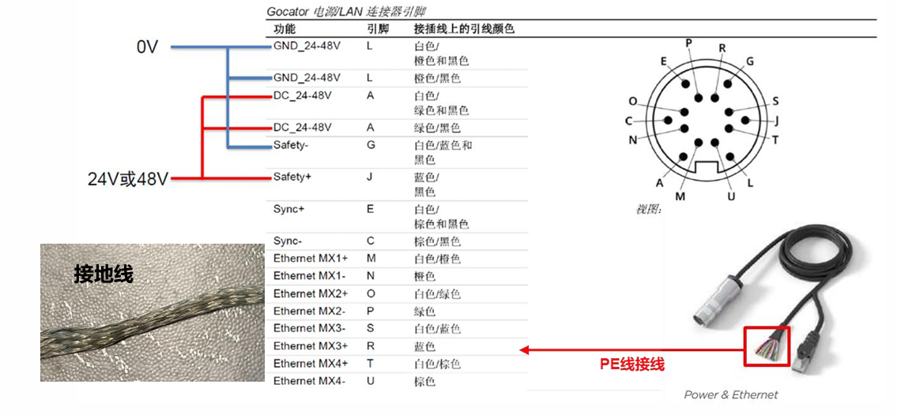](../images/gopxl_quickstart/PE线.png)

*PE线连接图*

[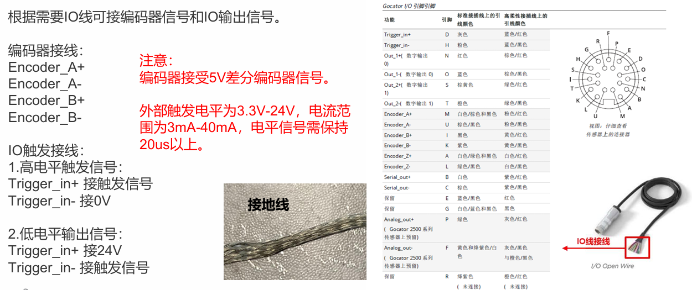](../images/gopxl_quickstart/IO线.png)

*IO线连接图*

---

## 3. 网络配置与启动 (Network & Bootup)

传感器上电后，需要配置电脑 IP 以建立通信并进入系统，相关工具包可在官网[下载](https://lmi3d.com/product-downloads/?searchdownloads=&productcategory=43&productcategoryone=48&productcategorytwo=1584&resourcecategory=%20&resourceindustry=%20&resourcefiletype=%20&softwarerelease=%20&action=mydownloadfilter)。

### 步骤 1：查找传感器 IP

1. 在 PC 端运行 `GoPxLDiscovery.exe`。
2. 软件将扫描并显示当前连接的传感器序列号（SN）及其默认 IP 地址（例如 `192.168.1.10`）。

[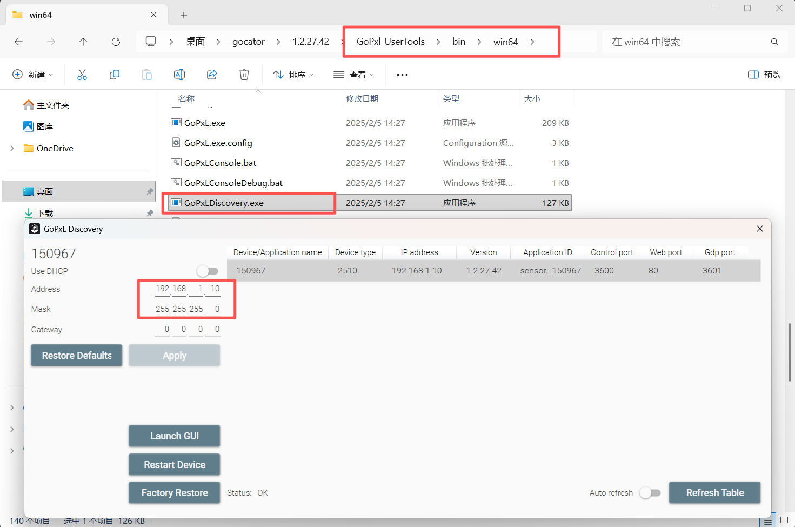](../images/gopxl_quickstart/Discovery.png)

*IP查找及修改*

### 步骤 2：电脑网卡设置

为了能访问传感器，电脑网卡必须与传感器处于**同一网段** 。

网卡IP设置 网卡电源管理 网卡巨帧设置 网卡双工设置

1. 打开电脑的网络设置 -> 传感器对应的网口 -> 属性 -> IPv4 属性。
2. 将 IP 手动设置为 `192.168.1.xxx`（xxx∈(0~255)且≠传感器IP最后一位，但前三位需与传感器一致），子网掩码设为 `255.255.255.0` 。

[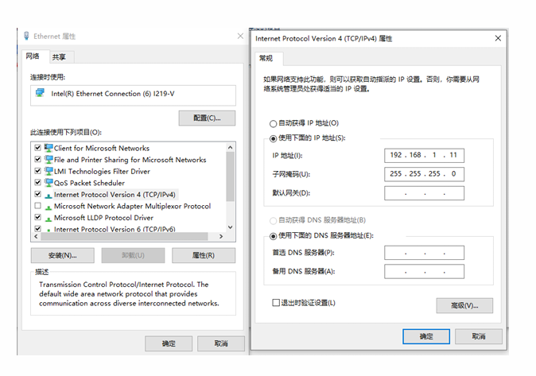](../images/gopxl_quickstart/IP.png)

*网卡IP设置*

[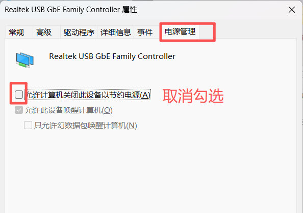](../images/gopxl_quickstart/电源管理.png)

*网卡电源管理设置*

[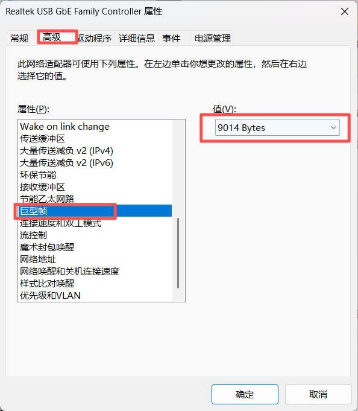](../images/gopxl_quickstart/巨帧.png)

*网卡巨帧设置*

[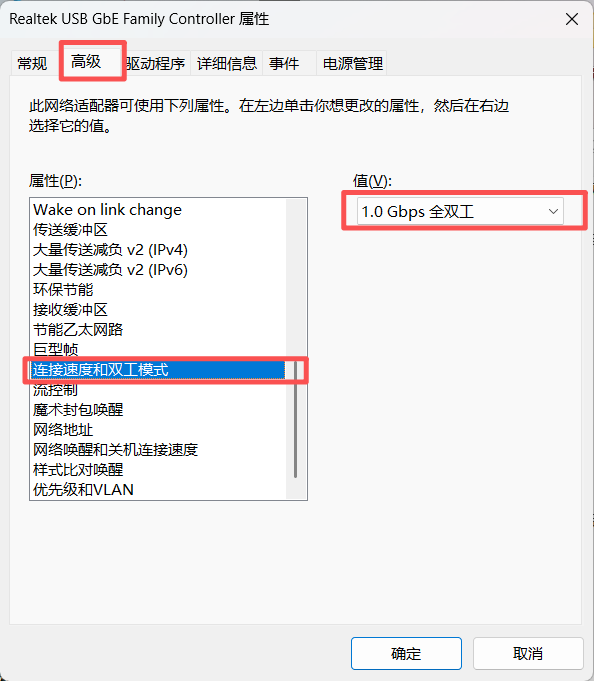](../images/gopxl_quickstart/双工.png)

*网卡双工设置*

### 步骤 3：登录 Web 调试界面

1. **推荐浏览器**：谷歌 Chrome、火狐或 Edge。建议暂时关闭防火墙和杀毒软件 。
2. 在浏览器地址栏输入传感器的 IP（如 `192.168.1.10`）并回车，即可进入 GoPxL 调试软件界面 。
3. **设置中文**：在界面右下角点击语言选项（默认显示 `EN`），选择 `中文(简体)` 。

[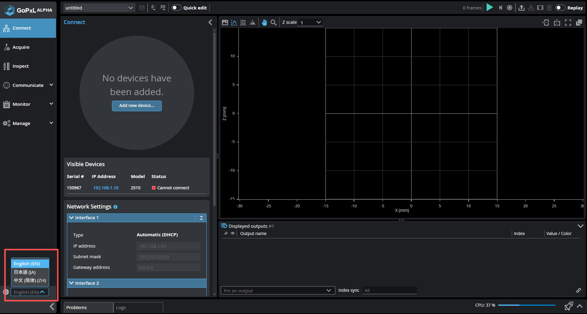](../images/gopxl_quickstart/语言.png)

*语言设置*

!!! tip "使用 GoPxL加速器 提升性能"
如果扫描速度要求极高或点云数据庞大，传感器内置 CPU 可能会遇到瓶颈。此时可运行 \*\*GoAccelerator (加速器)\*\*，将运算转移到电脑 CPU 上。开启后，需使用\*\*本地电脑 IP 加上 8100 端口\*\*（例如 `http://192.168.1.54:8100`）来访问提速后的网页界面 。

🚀 线激光连接 GoPxL 加速器步骤：

1. 运行程序2. 配置并启动3. 添加传感器4. 确认加速状态

- **运行**：双击鼠标左键运行 GoPxL.exe 程序，随后可以在桌面右下角的任务栏（系统托盘）找到它的运行图标。

[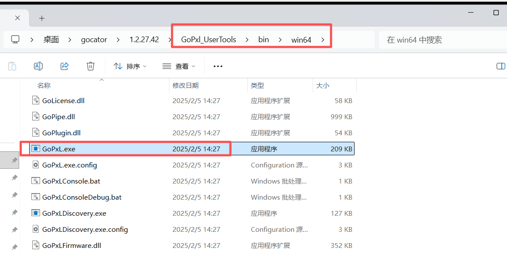](../images/gopxl_quickstart/加速器.png)

*加速器位置*

- **设置**：点击 "Add"，选择传感器对应的网口 IP，然后依次点击 "OK" -> "Start" -> "Launch"，系统会自动在浏览器中打开配置网页。

[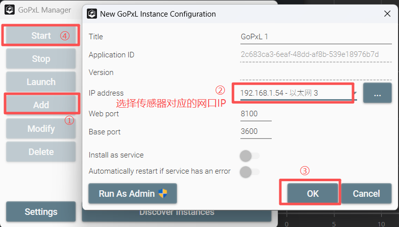](../images/gopxl_quickstart/加速1.png)

*加速器设置*

- **添加**：在打开的网页中，依次选择 "Design" -> "Add New Sensor..." -> "Gocator Laser Profiler"，勾选列表中找到的传感器，最后点击 "Add Sensor"。

[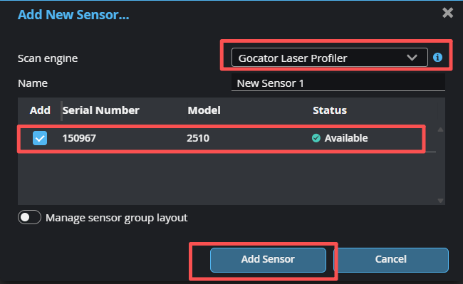](../images/gopxl_quickstart/加速2.png)

*添加传感器*

- **验证**：添加完成后，可以在页面上查看传感器的连接状态，确认加速器已成功接管。

[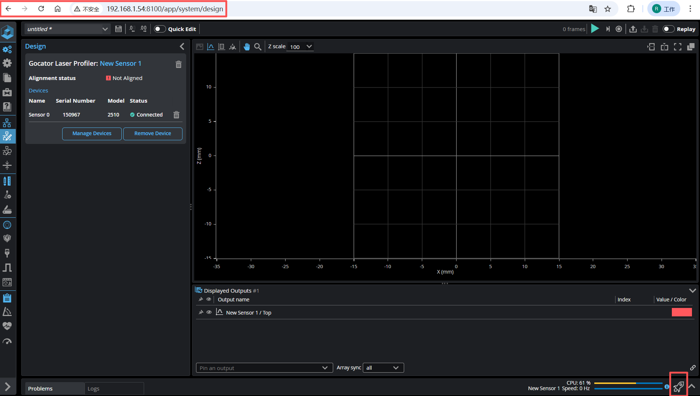](../images/gopxl_quickstart/加速状态.png)

*加速后的状态*

---

## 4. 快速出图与扫描设置 (Acquire)

成功登录界面后，导航至顶部的 **Acquire (采集)** 页面来获取您的第一张图像。

### 扫描模式 (Scan Mode)

- **Image (图像/视频模式)**：首次出图建议先使用此模式。它仅用于查看原始 2D 反射图像，方便您调节激光曝光度和验证物理焦距，不产生 3D 数据。
- **Profile (轮廓)**：用于截面测量（线激光），输出 2D 轮廓线。
- **Surface (表面)**：通过目标或传感器的相对移动，拼接生成完整的 3D 点云或高度图。

### 曝光调节与出图 (Exposure)

1. 将工件放置在传感器激光线正下方，启动传感器。
2. 选择 **轮廓模式**，触发模式选择 **时间模式**，调整 **Exposure (曝光)** 时间大小，确保激光线在画面中清晰且连续。
3. 调节传感器或样件的高度，直到被测表面的轮廓线在视野中间，此时高度是最合适的。具体的扫描设置详见下一章**扫描成像**(超链接待插入)。

---

## 5. 保存设置 (Manage -> Jobs)

!!! warning "非常重要"
所有的设置更改在传感器断电后都会丢失！请务必将其保存为 \*\*Job (任务)\*\* 文件。
[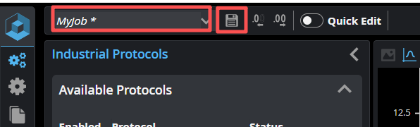](../images/gopxl_quickstart/保存.png)

*保存当前Job*

- **保存任务**：点击顶部全局工具栏的 **保存 (Save)** 图标，或在 **Manage > Jobs** 页面中保存。
- **切换任务**：在生产不同型号的产品时，可以通过 Web 界面或 PLC 命令快速加载不同的 Job 文件。
