# **📐 Gocator® 传感器选型指南**

[](https://img.shields.io/badge/VERSION-GoPxL_1.4-0078D7?style=for-the-badge)
[](https://img.shields.io/badge/AUTHOR-wu jian-6f42c1?style=for-the-badge)

📝 手册更新日志 (Changelog)

| 说明书版本 | 更新日期 | 更新者 | 更新说明 |
| --- | --- | --- | --- |
| **V1.0** | `2026-05-19` | **jian wu** | 完成初版本 |


---

作为一款高度集成化的智能视觉终端，Gocator 全系列产品在出厂前均已完成严苛的高精度光学标定。用户只需“开箱、安装、通电”，即可实现真正的即插即用（Plug-and-Play）。这不仅彻底免除了繁琐的现场底层校准工作，更大幅缩短了设备的部署与调试周期。

每一台智能传感器的型号代码（例如 2410、2520 或 5504）并非随机排列的数字，而是一份高度浓缩的“技术档案”。这些数字直观地揭示了该设备的底层技术路线、光源类型（如红光、蓝光或白光）、激光安全等级以及关键的硬件规格。

本章将为您解码隐藏在型号背后的重要信息，带您全面剖析传感器的核心性能参数。同时，我们将提供一套科学的评估逻辑，引导您如何将冰冷的参数表与复杂的实际现场需求相匹配，从而为您的项目锁定最合适的专属型号

**LMI传感器选型手册**
点击查看 [Gocator 3D 传感器](../images/gopxl_%20selection/BROCHURE_3D%20.pdf "点击预览或下载 PDF")。

## **1.LMI产品介绍**

LMI 的产品线主要围绕 Gocator 品牌展开，按扫描方式和应用场景可分为以下四大类

- [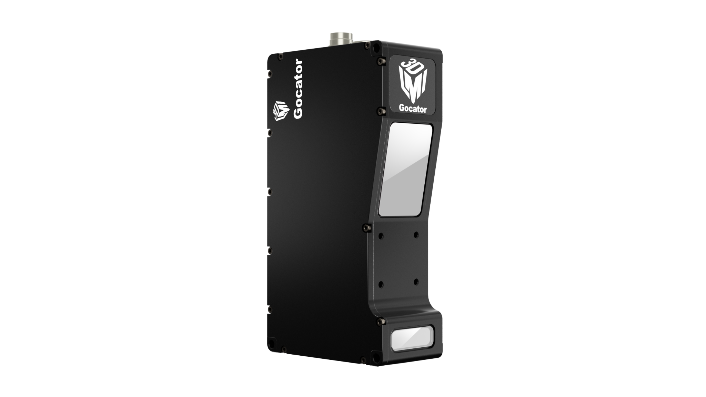 线激光](#section1)
- [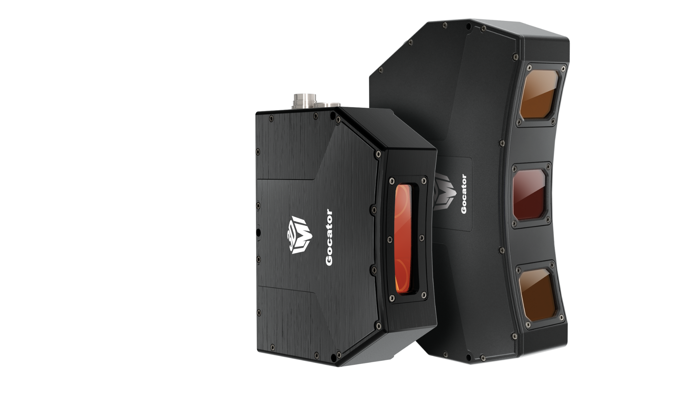 结构光](#section2)
- [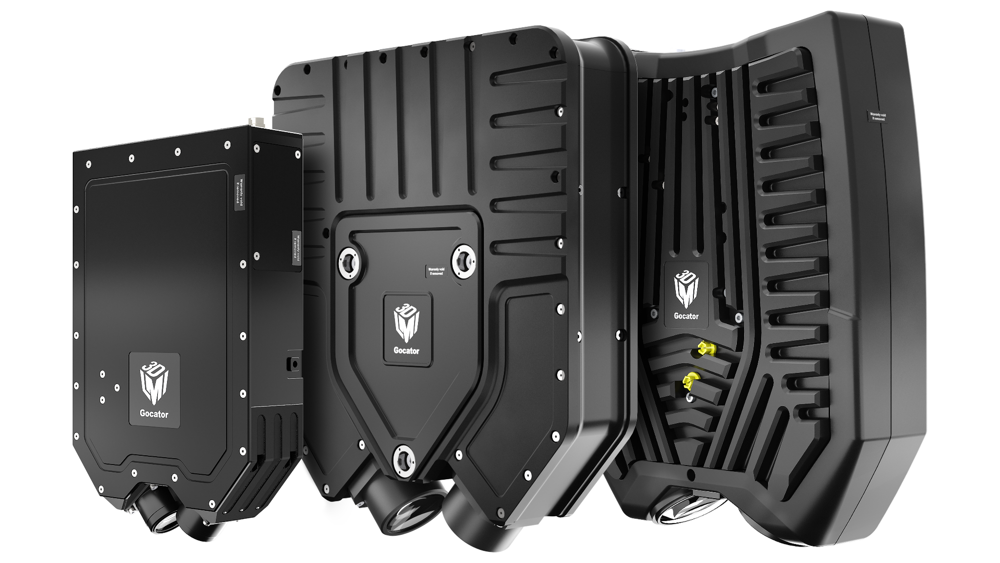 离轴线共焦](#section3)
- [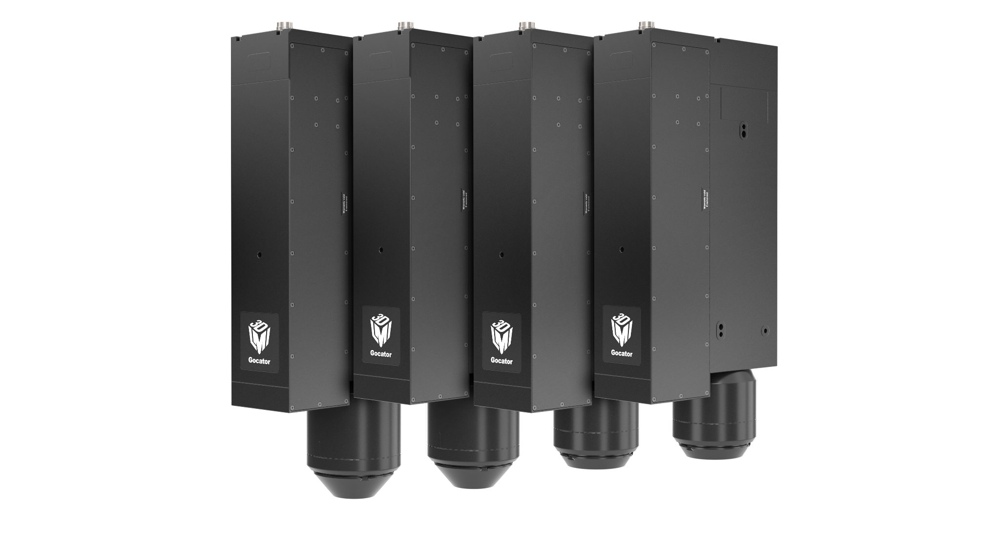 同轴线共焦](#section4)

具体的详细解释如下所示：

📏 1 线激光📸 2 结构光🌈 3 离轴线共焦🎯 4同轴线共焦

### 1.1 线激光轮廓传感器

线激光轮廓扫描仪

LMI线激光有如下5种系类,每款传感器对应的视野和激光颜色如下图所示

[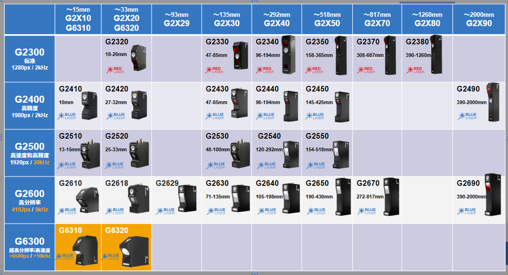](../images/gopxl_ selection/Line Profilers.png)

线激光系列

如果需要了解详细的参数信息,**请查看下面链接**

线激光DATASHEET详细介绍

点击查看 [Gocator 3D 2300系列DATASHEET](https://lmi3d.com/series/gocator-2300-series/?lang=zh-hans "跳转到 LMI 官网产品页")

点击查看 [Gocator 3D 2400系列DATASHEET](https://lmi3d.com/series/gocator-2400-series/?lang=zh-hans "跳转到 LMI 官网产品页")

点击查看 [Gocator 3D 2500系列DATASHEET](https://lmi3d.com/series/gocator-2500-series/?lang=zh-hans "跳转到 LMI 官网产品页")

点击查看 [Gocator 3D 2600系列DATASHEET](https://lmi3d.com/series/gocator-2600-series/?lang=zh-hans "跳转到 LMI 官网产品页")

点击查看 [Gocator 3D 6300系列DATASHEET](https://lmi3d.com/series/gocator-6300-series/?lang=zh-hans "跳转到 LMI 官网产品页")

### 1.2 结构光传感器

快照式结构光传感器

Gocator 3000 系列： 采用蓝色 LED 结构光，适合静止物体的 3D 检测。常配合协作机器人（如 UR）进行柔性制造中的零件定位或质控。

[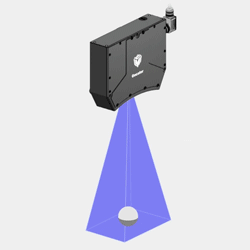](../images/gopxl_ selection/Snapshot Sensors.gif)

结构光

如果需要了解详细的参数信息,**请查看下面链接**

结构光DATASHEET详细介绍

点击查看 [Gocator 3D 3210系列DATASHEET](https://lmi3d.com/series/gocator-3210/?lang=zh-hans "跳转到 LMI 官网产品页")

点击查看 [Gocator 3D 3500系列DATASHEET](https://lmi3d.com/series/gocator-3500-series/?lang=zh-hans "跳转到 LMI 官网产品页")

### 1.3离轴线共焦传感器

离轴线共焦传感器

Gocator 5500 系列： 专门解决“疑难杂症”，如透明材质（玻璃/胶水）、高反光金属、深孔凹槽, 提供微米级的分辨率，主要用于半导体封装和 VR 镜片检测。  

[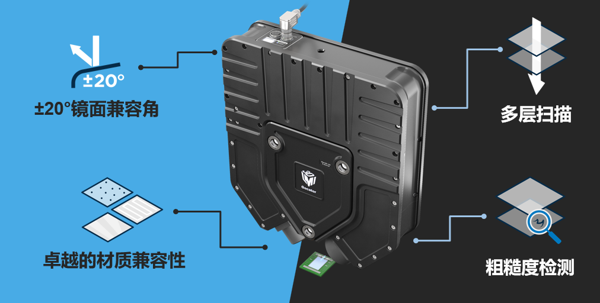](../images/gopxl_ selection/Line Confocal Sensors.png)

离轴线共焦传感器

如果需要了解详细的参数信息,**请查看下面链接**

离轴线共焦DATASHEET详细介绍

点击查看 [Gocator 3D 5500系列DATASHEET](https://lmi3d.com/series/gocator-5500-series/?lang=zh-hans "跳转到 LMI 官网产品页")

### 1.4同轴线共焦传感器

同轴线共焦传感器

Gocator 4000 系列： 目前视觉检测领域最顶尖的技术之一，它主要解决了传统激光三角反射式传感器在面对透明、高反光、多层材料或陡峭倾角时的检测难题。  

[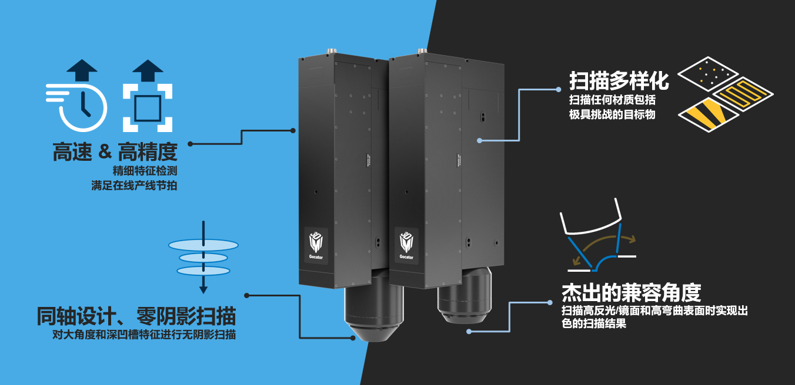](../images/gopxl_ selection/Coaxial line confocal sensor.png)

同轴线共焦传感器

如果需要了解详细的参数信息,**请查看下面链接**

同轴线共焦DATASHEET详细介绍

点击查看 [Gocator 3D 4000系列DATASHEET](https://lmi3d.com/series/gocator-4000-series/?lang=zh-hans "跳转到 LMI 官网产品页")

---

## **2. 需求导向：如何选择您的传感器？**

我们建议通过以下问题，层层递进地锁定您的最佳传感器：

```
flowchart TD
    %% 定义全局样式
    classDef default font-size:18px,fill:#f8f9fa,stroke:#ced4da,stroke-width:2px;
    classDef endNode1 fill:#fff9c4,stroke:#f57f17,stroke-width:2px;
    classDef endNode fill:#e8f5e9,stroke:#2e7d32,stroke-width:2px;

    A((选型流程)) --> B{物体状态?}

    %% 第一层分支
    B -->|静止| C[优先选择结构光]:::endNode1
    B -->|运动| D[选择线激光]

    %% 结构光分支的后续
    C --> E{精度是否满足?}
    E -->|是| F([✅ 选型结束]):::endNode
    E -->|否| G[转用线激光]

    %% 殊途同归：汇总到继续线激光选型
    G --> H[[继续线激光选型]]:::endNode
    D --> H
```

**图 1：LMI 传感器初步选型**

**如果按照上述流程没有选择到合适的传感器,请通过回答以下4个核心问题，选择最佳传感器**

- [检测物体的材质](#section7)
- [检测物体的大小](#section8)
- [检测物体的精度](#section9)
- [检测物体的速度](#section10)

### 2.1 **检测物体的材质**

根据您的材质，对应下面的表格，选择合适的传感器

| 材质类型 | 推荐技术 | 推荐型号系列 | 技术优势与特点 |
| --- | --- | --- | --- |
| **普通非透明材质** *(如塑料、木材、哑光金属)* | **红光激光** | 2300 / 2400 / 2500 /2600/6300系列 | 适用性广，标准轮廓检测的最高性价比选择。 |
| **高反光 / 精密机加工件** *(如镜面金属)* | **蓝色激光** | 2500 / 2600/6300 系列 | 蓝光波长短、不易穿透表面，能在光洁表面形成更锐利的轮廓。 |
| **透明 / 半透明 / 多层材料** *(如玻璃、胶路、屏幕、晶圆)* | **3D 线共焦&线激光** | 4000 / 5500/ 6300 系列 | 基于色散共焦原理，可无盲区扫描，并同时解析多达 8 层内部结构。 |

在评估和选型 LMI Gocator 3D 传感器时，激光颜色（波长）和激光等级（功率与安全性）是极其关键的硬件参数。关于激光等级和波长的详细介绍，请看**隐藏部分**。

根据材质选择传感器型号和激光等级详细介绍

**LMI Gocator 系列选型参考：激光等级与激光波长**

激光等级：2/3R vs 3B 光源选型：红光 vs. 蓝光

| 传感器系列 | 性能等级定位 | 光源配置与安全级别 | 🌟 核心优势 | 🎯 典型应用场景 |
| --- | --- | --- | --- | --- |
| **Gocator 2300** | **工业标准级** | 🔴 红光 🟢 Class 2/3R/3B | **视野与精度的完美平衡** | 汽车冲压件检测、轮胎检测、木材扫描。 |
| **Gocator 2500** | **极速与反光级** | 🔵 蓝光 🔴 Class 2/3R/3B | **无惧强反光与超高帧率** | 高抛光金属中框、玻璃边缘检测。 |

| 光源类型 | 核心定位 | 代表型号 | 🌟 核心优势与适用场景 |
| --- | --- | --- | --- |
| **🔴 红光** | **通用型主导** | **2300/2400 系列** | **入门级扫描：** 成本平衡，适用大多数粗糙表面材质。 |
| **🔵 蓝光** | **高反光克星** | **2500/6300 系列** | **超高分辨率：** 专攻微小物（连接器引脚、亮面金属）。噪点极低。 |

**激光等级与波长的详细解释**

#### 2.1.1激光等级与波长选择

⚡ 激光等级🎨 激光波长(颜色)

##### 2.1.1.1.激光等级

激光等级详细说明

激光等级

激光等级代表了激光器的输出功率。功率越大，打在物体上的激光线就越亮，传感器就越容易捕捉到反射回来的光。LMI 传感器常见的等级是为2 级、2M级、3R级或3B级类。

在 3D 激光轮廓扫描应用中，激光等级直接决定了传感器在**高速运动**与**低反射率材质**场景下的表现。以下是两者的核心差异：

| 激光等级 | 核心定位 | 功率水平 | 🌟 LMI 传感器应用优势 (性能表现) | ⚠️ 局限性与部署挑战 |
| --- | --- | --- | --- | --- |
| **🟢 Class 2M / 2/3R** | **安全与易用性优先** | 低功率 (通常 < 1mW) | **部署零门槛：** 适合常规反光材质与标准线体速度。 | **吸光材质与帧率瓶颈：** 遇到高吸光（如纯黑橡胶/塑料）或漫反射极弱的材质时，传感器 CMOS 接收到的反射光子不足。**必须延长曝光时间**来获取清晰轮廓，这会直接导致**最大扫描帧率大幅骤降**。 |
| **🔴 Class 3B** | **极限速度与材质宽容度优先** | 高功率 (几十至数百 mW) | **无惧黑物与超高帧率：** 激光束极强劲。 | **集成成本较高：** 极高的光强可能带来散斑干扰（可通过 LMI 内部算法优化）。 |

##### 2.1.1.2激光颜色

激光颜色详细说明

传感器激光颜色

在 LMI Gocator 的 3D 激光轮廓传感器产品线中，激光颜色（即激光波长）主要分为两种：红光和蓝光。

3D 传感器光源选型：红光 vs. 蓝光

| 激光类型 | 波长与核心物理特性 | 🌟 最佳适用场景与材质 |
| --- | --- | --- |
| **🔴 红光** | **635-660nm (长波长)** 通用性强、成本相对较低。 | **绝大多数普通不透明材质：** 纸板、木材、哑光塑料、表面粗糙的金属等常规检测场景。 |
| **🔵 蓝光** | **405-450nm (短波长)** 光子能量高、聚焦极锐利、穿透力弱。 | **1. 半透明/漫反射材质：**因无法穿透表面，能在硅胶/塑料上形成极细的锐利光线，精度极高。 **2. 高反光/机加工金属：**（如 CNC 零件、手机金属壳）能大幅减少漫射噪点，提供极其干净的点云数据。 |

#### 2.1.2.激光等级和波长(颜色)选择案例

👉 点击展开查看：激光等级和颜色选择应用案例

LMI 传感器激光选型实战案例

| 选型维度 | 案例场景 | 🎯 核心检测需求 | ✅ 推荐选型 | 💡 选型核心理由 (物理与安全依据) |
| --- | --- | --- | --- | --- |
| **激光等级** (安全与功率) | **案例 A：消费电子组装** (手机中框平整度检测) | 高精度测量，但产线人员密集，环境相对开放。 | **2M 级激光** (低功率) | **安全与易用优先：** 2M 级在正常操作下对人眼安全（依赖眨眼反射）。**无需加装封闭式防护罩**，降低了产线改造成本，适合开放式人工线。 |
|  | **案例 B：高速轮胎检测** (胎面轮廓高速扫描) | 极高的线速度 + **纯黑色橡胶（极度吸光）**。 | **3B 级激光** (高功率) | **暴力穿透与极限曝光：** 黑胶极度吸光，只有高功率 3B 激光才能在极短曝光时间内拿到足够的反射信号。**警告：** 必须配备物理遮光罩和安全联锁。 |
| **激光颜色** (波长穿透力) | **案例 C：锂电池与机加工** (极片/反光金属件) | 强金属光泽表面、或高温红热物体（如钢坯）检测。 | **蓝色激光** (405/450nm) | **抗散射与抗噪：** 蓝光波长短，打在金属表面**散射极小、线型极锐利**。同时能完美避开高温物体自发的热辐射（红外频段），滤除背景噪声。 |
|  | **案例 D：木材与常规自动化** (原木轮廓扫描) | 常规漫反射材质（木材、纸板、哑光塑料），无极端反光。 | **红色激光** (650-660nm) | **高性价比与成熟度：** 对常规漫反射材质表现极稳。技术成熟、成本低，是通用大视野场景下的最具性价比选择。 |

### 2.2 **检测物体的大小**

根据您的产品大小，对应下面的表格，选择合适的视野和测量范围

| 选型维度 | 核心选型原则 | 进阶挑战与解决方案 |
| --- | --- | --- |
| **X 轴视野 (FOV)** | **X FOV > 物体最大宽度 + 摆放偏差余量** 建议预留 10%-20% 的边缘缓冲 | **精度受限：** 采用**多台传感器并排拼接**，兼顾宽视野与高精度。 |
| **Z 轴量程 (Range)** | **Z 量程 > 物体高度起伏 + 机构上下跳动余量** | **扫描断层：** 量程不足会导致点云截断。安装时需严格校对安装净距 (CD)。 |
| **超大物体检测** | **突破单台物理极限** | **Gocator 智能组网：** 原生支持最多 **24 台** 传感器一键无缝拼接。 |

关于激光视野和检测范围的详细信息，请看**隐藏部分**。

根据物体大小选择传感器视野的详细介绍

**LMI Gocator 全系列扫描视野 (FOV) 与测量深度 (MR) 范围对照**

2300系列 2400系列 2500系列 2600系列 6300系列

| 传感器型号 | 净距 (CD) | 景深 / 测量范围 (Z轴 MR) | 梯形视野 (X轴 FOV, 近端 - 远端) | 🎯 典型应用场景与定位 |
| --- | --- | --- | --- | --- |
| **Gocator 2320** | 40 mm | **25 mm** | **18 mm - 26 mm** | **极微距精密检测：** SMT元器件引脚。 |
| **Gocator 2330** | 90 mm | **80 mm** | **47 mm - 85 mm** | **小型零部件检测：** 手机外壳、精密冲压件。 |
| **Gocator 2340** | 190 mm | **210 mm** | **96 mm - 194 mm** | **中小型常规件：** 汽车中小铸件、大尺寸 PCB。 |
| **Gocator 2350** | 300 mm | **400 mm** | **158 mm - 365 mm** | **中型起伏工件：** 食品烘焙线、中型汽车件。 |
| **Gocator 2370** | 400 mm | **500 mm** | **308 mm - 687 mm** | **大型较深目标：** 轮胎胎面轮廓提取。 |
| **Gocator 2375** | 650 mm | **1350 mm** | **324 mm - 1010 mm** | **超大落差专用：** 1.35 米极长景深。 |
| **Gocator 2380** | 350 mm | **800 mm** | **390 mm - 1260 mm** | **超宽视野满载：** 物流线大纸箱体积测量。 |

| 传感器型号 | 净距 (CD) | 景深 (Z轴 MR) | 梯形视野 (X轴 FOV) | 🌟 核心定位与应用 |
| --- | --- | --- | --- | --- |
| **Gocator 2410** | 19 mm | **6 mm** | **6.5 mm - 10 mm** | **极限精密级：** 亚微米级分辨率，微小芯片。 |
| **Gocator 2420** | 60 mm | **25 mm** | **27 mm - 32 mm** | **微型精密级：** 手机精细零部件检测。 |
| **Gocator 2430** | 75 mm | **80 mm** | **47 mm - 85 mm** | **小型高分辨率：** 精密机加工件。 |
| **Gocator 2440** | 183 mm | **210 mm** | **96 mm - 194 mm** | **中型高分辨率：** 汽车电池组零件。 |
| **Gocator 2450** | 270 mm | **550 mm** | **145 mm - 425 mm** | **大景深高精：** 中型复杂起伏工件。 |
| **Gocator 2490** | 350 mm | **1525 mm** | **390 mm - 2000 mm** | **超大视野旗舰：** 单头覆盖 2 米宽度。 |

| 传感器型号 | 净距 (CD) | 景深 (Z轴 MR) | 梯形视野 (X轴 FOV) | 🌟 核心定位 |
| --- | --- | --- | --- | --- |
| **Gocator 2510** | 17.0 mm | **6 mm** | **13.0 mm - 14.5 mm** | **极速微距级：** 10kHz 高速 3D 提取。 |
| **Gocator 2512** | 17.0 mm | **6 mm** | **13.0 mm - 14.5 mm** | **玻璃定制：** 扫描透明玻璃与塑料外框。 |
| **Gocator 2520** | 47.5 mm | **25 mm** | **25.0 mm - 32.5 mm** | **极速精密级：** 手机金属中框、CNC 高亮面。 |
| **Gocator 2522** | 17.75 mm | **25 mm** | **25.0 mm - 32.5 mm** | **镜面特规版：** 专克抛光晶圆与 3D 玻璃边缘。 |

| 传感器型号 | 净距 (CD) | 景深 (Z轴 MR) | 梯形视野 (X轴 FOV) | 🌟 旗舰定位 |
| --- | --- | --- | --- | --- |
| **Gocator 2610** | 19.5 mm | **5.0 mm** | **10.2 mm - 10.8 mm** | **4K 极限微距：** 像素点距 2.5 微米。 |
| **Gocator 2690** | 325 mm | **1550 mm** | **385 mm - 2000 mm** | **4K 巨无霸：** 单台覆盖 2 米视野。 |

| 传感器型号 | 净距 (CD) | 景深 (Z轴 MR) | 视野 (X轴 FOV) | 🌟 旗舰定位 |
| --- | --- | --- | --- | --- |
| **Gocator 6310** | 18.15 mm | **5.5 mm** | **13.4 mm - 14.5 mm** | **6.5K 远心微距：** 彻底消除遮挡盲区。 |

#### 2.2.1传感器视野

📏 Z测量范围👁️ 视野大小🏗️ 安装净距离

##### 2.2.1.1.Z测量范围

测量范围详细说明

测量范围

传感器在 Z 轴（深度/高度）方向上能够有效成像的有效范围。物体的高低起伏必须落在这个区间内。

[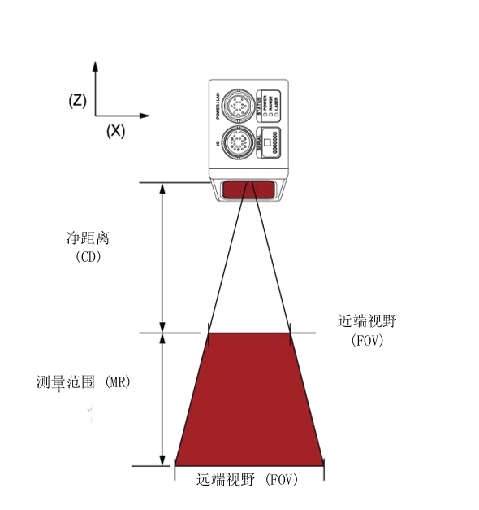](../images/gopxl_ selection/Measurement Range.png)

LMI传感器 测量范围&安装距离&视野示意图

##### 2.2.1.2视野大小

视野详细说明

视野大小

| 视野区域 | 空间位置 (Z 轴) | X 轴有效测量宽度 | 🌟 选型与安装调试警告 |
| --- | --- | --- | --- |
| **近端视野 (Near FOV)** | 靠近传感器镜头处 | **较窄** | 当测量带有一定高度的物体时，必须确保物体的**最高表面**依然落在这一最窄区间内，否则顶部边缘数据会丢失。 |
| **远端视野 (Far FOV)** | 远离传感器镜头处 | **较宽** *(随光学几何自然发散)* | 扫描较宽大的物体时，需利用远端展宽的特性，确保物体的**最宽底部**能被完整覆盖。 |
| **整体有效视野** | 整个测量深度 (MR) | **典型的梯形空间分布** *(近窄远宽)* | **绝非理想矩形！** 安装间距 (Clearance Distance) 会直接改变被测物切入视野的截面宽度。必须严格计算目标物在 Z 轴起伏时的 X 轴边界。 |

[](../images/gopxl_ selection/Measurement Range.png)

LMI传感器 测量范围&安装距离&视野示意图

##### 2.2.1.3.安装净距离

安装净距离详细说明

安装距离

1.从传感器的受光窗（底面）到“测量范围”起始边界之间的距离 。

2.在设计支架时，“安装高度 = 净距离 + 1/2 测量范围” 通常是最稳妥的方案。这样可以确保当待测物体有
一定的厚度变化或位置波动时，它依然始终保持在传感器的“可视区域”内。

[](../images/gopxl_ selection/Measurement Range.png)

LMI传感器 测量范围&安装距离&视野示意图

#### 2.2.2.传感器视野选择案例

👉 点击展开查看：传感器传感器视野选择应用案例

产品宽度170mm，长度240mm，高度3mm，客户需求是沿着长边方向进行扫描，这个指的是普通的材料，因此需要选择大视野景深大于3mm的传感器(备注:这个是根据尺寸大小初选的型号，最终的型号需要结合**精度**一起选择)，如果是高反光或者透明的材料，需要选择特定的传感器。

[](../images/gopxl_ selection/Sample 1.png)

样品尺寸

### 2.3 **检测物体的精度**

在 3D 视觉和工业检测领域，分辨率和精度是评估传感器性能的两个“灵魂”参数。**Y分辨率决定扫描的速度（备注:Y分辨率是自己根据需求可以定义的），如果Y方向分辨率越大，扫描速度越快，Y方向分辨率越小，扫描速度越慢，具体信息请看2.4章-检测物体的速度** 。

| 测量目标 | 依赖的核心参数 | 工业界“黄金法则” (Rule of Thumb) | 选型示例与计算逻辑 |
| --- | --- | --- | --- |
| **寻找微小瑕疵** | **X 分辨率** | **X 分辨率 ≤ 瑕疵宽度的 1/3 ~ 1/4** | 目标 100μm 划痕，选型 X 分辨率 ≤ 30μm。 |
| **识别极小高度差** | **Z 分辨率** | **Z 分辨率 ≤ 目标高度起伏的 1/5** | 目标 20μm 鼓胀，选型 Z 分辨率需亚微米级。 |
| **测量严苛尺寸公差** | **Z 重复精度** | **Z 轴重复精度 ≤ 客户公差带的 1/10** | 目标公差 ±0.05mm，选型 Z 重复精度 ≤ 10μm。 |

关于激光精度和分辨率的详细信息，请看**隐藏部分**。

根据检测精度选择传感器分辨率的详细介绍

**LMI Gocator 全系列核心精度与分辨率参数对照**

2300 系列 2400 系列 2500 系列 2600 系列 6300 系列 5500 系列

| 传感器型号 | X 分辨率 (μm) | Z 线性度 (Linearity) | Z 重复精度 (μm) | 🎯 核心精度表现 |
| --- | --- | --- | --- | --- |
| **Gocator 2320** | 14.0 - 21.0 | ±0.01% MR | **0.4** | **基础精密：** 稳定的微米级重复性。 |
| **Gocator 2330** | 44.0 - 75.0 | ±0.01% MR | **0.8** | **平衡选型：** 零件尺寸测量。 |

| 传感器型号 | X 分辨率 (μm) | Z 线性度 (Linearity) | Z 重复精度 (μm) | 🌟 核心精度表现 |
| --- | --- | --- | --- | --- |
| **Gocator 2410** | 5.8 - 6.2 | ±0.015% MR | **0.2** | **极精线性：** 半导体级高准确度。 |
| **Gocator 2420** | 14.0 - 16.5 | ±0.006% MR | **0.4** | **微距标杆：** 3C 精密结构件。 |

| 传感器型号 | X 分辨率 (μm) | Z 线性度 (Linearity) | Z 重复精度 (μm) | 🌟 核心精度表现 |
| --- | --- | --- | --- | --- |
| **Gocator 2510** | 8.0 | ±0.015% MR | **0.2** | **极速线性：** 10kHz 扫描数据稳定。 |
| **Gocator 2520** | 13.0 - 17.0 | ±0.006% MR | **0.4** | **高速准确：** 产线在线全检。 |

| 传感器型号 | X 分辨率 (μm) | Z 线性度 (Linearity) | Z 重复精度 (μm) | 🌟 核心精度表现 |
| --- | --- | --- | --- | --- |
| **Gocator 2610** | 2.5 | ±0.015% MR | **0.22** | **4K 极精细：** 极高密度点云还原。 |

| 传感器型号 | X 分辨率 (μm) | Z 线性度 (Linearity) | Z 重复精度 (μm) | 🌟 核心精度表现 |
| --- | --- | --- | --- | --- |
| **Gocator 6310** | < 2.1 | ±0.005% MR | **0.15** | **远心线性：** 消除透视偏差。 |

| 传感器型号 | X 轴分辨率 (μm) | Z 线性度 (Linearity) | Z 重复精度 (μm) | 🌟 核心精度表现 |
| --- | --- | --- | --- | --- |
| **Gocator 5504** | 2.5 | ±0.03% MR | **0.05** | **层析线性：** 分辨多层结构。 |
| **Gocator 5512** | 6.5 | ±0.07% MR | **0.20** | **准确层析：** 针对薄膜厚度测量。 |
| **Gocator 5516** | 9.9 | ±0.04% MR | **0.25** | **宽幅线性：** 维持优异的层析精度。 |

#### 2.3.1分辨率与精度

在3D视觉和工业检测领域，**分辨率** 和 **精度** 是评估传感器性能的两个“灵魂”参数。它们直接决定了你项目的成败。

- ****举例说明****
  ---
  如果分辨率不足，复杂的特征会发生“平滑”或“丢失”。

  👇 点击展开：详细说明
  1. **特征提取**： 在检测 CPU 针脚、手机中框缝隙或微小划痕时，必须有足够的点云密度（高 X/Y 分辨率）才能勾勒出边缘。
  2. **点云质量**： 高分辨率意味着点云更平滑，在进行 3D 匹配或体积计算时，噪点更少，数据更扎实。
- ****举例说明****
  ---
  如果精度达不到要求，测量数据就失去了指导生产的意义。

  👇 点击展开：详细说明
  1. **公差控制**:工业零件通常有严格的公差，如果传感器的精度（包含重复精度）无法覆盖这个范围，就会产生大量的误判（把合格品测成废品）或漏判。
  2. **装配配合**:在机器人引导抓取或精密装配中，如果精度偏差 1mm，机械臂就可能撞毁工件或无法塞入孔位。

具体解释如下所示：

📏 X 分辨率🔬 Z 分辨率🎯 Z 线性度

##### 2.3.1.1.X 分辨率

X 分辨率详细说明

X 分辨率

激光线上相邻两个数据点之间的物理间距。由于视野是梯形的，近端 (Near End) 的 X 轴分辨率总是高于远端 (Far End)。当对分辨率要求极高时，应尽量将目标物放置在测量范围的近端。

[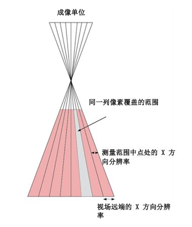](../images/gopxl_ selection/X Resolution.png)

X 轴分辨率

##### 2.3.1.2.Z 分辨率

Z 分辨率详细说明

Z 分辨率

Z分辨率是指传感器能够检测到的最小高度差异。如果一个物体的表面起伏小于这个数值，传感器可能无法感知到这种变化，其结果在数据上会表现为平整表面或噪声，**Z分辨率越小，传感器“看得越细”**。目前传感器没有标注分辨率，只标注了Z方向重复性，所以，小视野的传感器用重复性乘以3倍，大视野用重复性乘以12倍，可以理解成Z方向上的精度。

[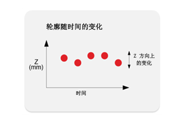](../images/gopxl_ selection/Z resolution.png)

Z分辨率

##### 2.3.1.3.Z线性度

Z线性度详细说明

Z线性度

如果说“Z 分辨率”代表传感器能看多细，那么“Z 线性度”就代表传感器看得到底准不准。

Z 线性度是指传感器在整个测量范围内（Measurement Range），测量值与真实物理高度之间最大偏差的百分比。

简单来说，如果你把一个标准量块从传感器的最顶端移到最底端，传感器测得的位移值与量块实际厚度之间的差值，就是线性度误差。它通常表示为：

[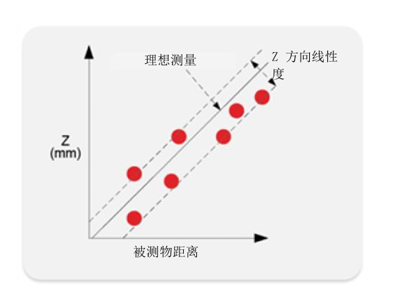](../images/gopxl_ selection/Z Linearity.png)

Z线性度

#### 2.3.2.传感器精度选择案例

👉 点击展开查看：传感器精度选择应用案例

案例背景：手机中框精密检测检测要求：

高度测量：测量中框四个角到基准面的绝对高度，公差要求为±0.05mm。

缺陷检测：识别中框表面是否存在深度超过0.01mm的微小划痕。

视野需求： 手机长约240mm，宽约150mm。

**第一步**：根据“Z 分辨率”筛选（针对划痕）要检测 10um 的划痕，根据工程经验，传感器的 Z 分辨率至少要达到目标尺寸的 1/3 到 1/5。

计算： 10 / 5 = 2um。

选型结论：我们需要一台`Z分辨率在2um`左右的传感器。

Gocator 2510 的Z分辨率约为 2.0um，`符合要求`。

Gocator 2410 的Z分辨率约为6.0um，可能无法稳定识别极微小的划痕。

**第二步**：根据“Z 线性度”筛选（针对绝对高度）公差要求是±0.05mm.根据测量系统分析(MSA)原则，传感器的线性误差(准确度)应该占公差带的10% - 20%。

计算： 0.05\*10% = 0.005mm。

评估：假设选用的传感器量程(MR)为20mm，线性度为±0.01%。

线性度误差 =20\*0.01% = 2um。

选型结论:2um < 5um，该传感器的线性度完全满足绝对高度测量的精度要求。

**第三步**：平衡视野(FOV)与安装由于手机宽度有 80mm：

方案 A：使用单台宽视野传感器(如Gocator2440)。虽然视野够了，但其Z分辨率(约13um)太粗，无法看清划痕。

方案 B：使用多台高精度传感器(如2台Gocator2510)进行拼接扫描，或者将传感器安装在机械臂/模组上进行往复扫描。

**通过上述分析选择方案B**

**选型避坑指南：**

1.不要只看近端：检查你的物体摆放位置。如果物体靠近量程边缘（远端），请以远端的分辨率和线性度为准。

2.材质影响：手机中框如果是高反光金属，可能需要选择 Blue Laser(蓝光)型号(如2510 默认就是蓝光)，因为蓝光在金属表面的成像质量比红光更好，噪声更低。

### 2.4 **检测物体的速度**

扫描速度的计算公式：速度=最高频率 \* Y方向的触发间隔\*0.9。

关于激光扫描速度的详细信息，请看**隐藏部分**。

根据扫描速度选择频率的详细介绍

**LMI Gocator 全系列扫描频率与速度性能对照表**

2300系列  2400系列  2500系列  2600系列  6300系列  3000系列  4000/5500系列

| 传感器系列 | 极限帧率 | 🚀 速度特性应用 |
| --- | --- | --- |
| **Gocator 2300** | **最高 5,000 Hz** | 适合大多数标准工业流水线（如轮胎、木材、建筑材料）。 |

| 传感器系列 | 极限帧率 | 🚀 速度特性应用 |
| --- | --- | --- |
| **Gocator 2400** | **最高 5,000 Hz** | 针对 3C 精密组装线优化，平衡了高分辨率与生产节拍。 |

| 传感器系列 | 极限帧率 | 🚀 速度特性应用 |
| --- | --- | --- |
| **Gocator 2500** | **最高 20,000 Hz** | **行业天花板：** 专为锂电极片、铝箔、极高速零件在线检测设计。 |

| 传感器系列 | 极限帧率 | 🚀 速度特性应用 |
| --- | --- | --- |
| **Gocator 2600** | **最高 10,000 Hz** | **高吞吐量：** 在 4K 像素的高负荷下依然能维持极高的扫描频率。 |

| 传感器系列 | 极限帧率 | 🚀 速度特性应用 |
| --- | --- | --- |
| **Gocator 6300** | **>1700 Hz** | 由于 6.5K 像素密度极大，更侧重于精密半导体抽检。 |

| 传感器系列 | 典型循环周期 | 触发延迟 | 🚀 速度特性应用 |
| --- | --- | --- | --- |
| **Gocator 3000** | 150 ms - 600 ms | < 1 ms | **非连续扫描：** 必须静态拍摄，通过“拍照”模式获取面阵点云。 |

| 传感器系列 | 采样/脉冲频率 | 🚀 速度特性应用 |
| --- | --- | --- |
| **Gocator 4000** | **最高 36,000 Hz** | 光谱共焦点扫描，专为极限落差表面的极速跟踪设计。 |
| **Gocator 5500** | **最高 40,000 Hz** | 线共焦技术，支持在极高线速度下进行多层材料层析。 |

#### 2.4.1.扫描速度

扫描速度详细说明

扫描速度

扫描速度通常被称为轮廓率 (Profile Rate)或帧率，单位通常是Hz(赫兹，即每秒扫描的轮廓或帧数)。它指的是传感器硬件从物理世界捕捉图像数据的快慢,在软件中通过限制Z窗口(缩小MR)，可成倍提升扫描频率,具体能做到多少，需要根据实际的检测来看，通俗的来说，扫描速度的快慢，决定你扫描一个产品需要用多长时间。

扫描速度的计算公式：速度=最高频率 \* Y方向的触发间隔\*0.9。

[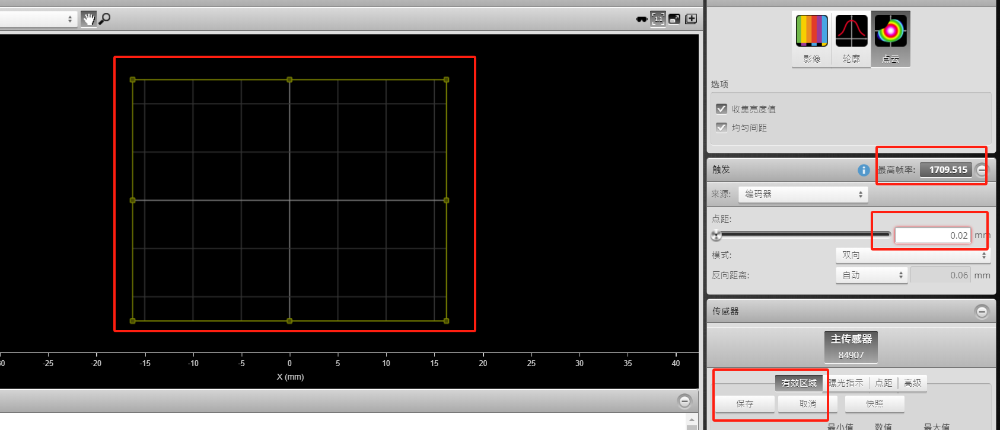](../images/gopxl_ selection/Scan Rate.png)

扫描速度

#### 2.4.2.传感器扫描速度案例

👉 点击展开查看：传感器扫描速度应用案例

案例一：高速橡胶轮胎挤出成型（追求极限扫描频率）

应用场景： 轮胎工厂的挤出生产线上，刚成型的黑色橡胶条以极快的速度连续不断地向前输送。需要实时检测橡胶表面的鼓包、划痕或尺寸偏差。

速度挑战： 橡胶条移动速度极快(假设达到1000mm/s)。如果要检测出长度仅为1mm的微小鼓包，Y向点距至少要做到0.5mm以保证不漏检。

扫描速度分析： 根据公式计算= 1000/0.5 = 2000HZ。这意味着LMI传感器必须至少以2000Hz的速度连续扫描。

优化策略： 为了达到甚至超过这个速度，工程师通常会在Gocator系统中进行FOV裁剪。由于橡胶条的高度波动在一个固定范围内，工程师会把Z的扫描范围限制在刚刚好包住橡胶条的区域，从而将扫描速度飙升至 4000Hz甚至更高，实现超高分辨率的高速检测。

## **3. 选型总结与资源获取**

通过以上六步的维度筛查，您应该已经锁定了最佳的技术路线（激光/共焦/快照）及 1-2 款目标型号,具体详细资料，您可以访问LMI官网。
点击查看 [Gocator 3D 传感器](https://lmi3d.com/?lang=zh-hans/ "跳转到 LMI 官网产品页")。

!!! info "下一步建议：验证与测试"
1. \*\*查阅详细规格\*\*：请查阅用户手册末尾的参数表，核对 Z 向线性度百分比、不同测量范围下的频率曲线图等。
2. \*\*申请样机测试\*\*：由于实际的 Z 轴精度会受目标物表面反光特性的显著影响，建议联系 \*\*LMI Technologies\*\* 官方销售或授权代理商，申请样机对真实材质进行实测。
